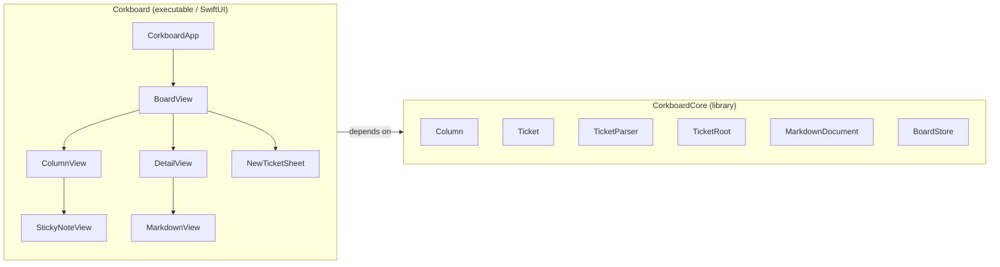

# Corkboard — SDLC Review

**macOS kanban board backed by a `tickets/` folder of markdown files.**
Swift 5.10 · SwiftUI · SPM · ~3 000 LOC across 15 files · MIT License · 2 commits on `main`

---

## Architecture

Clean two-target split: **CorkboardCore** is a pure-logic library with zero UI imports; the **Corkboard** executable owns all SwiftUI. The core is independently testable. No third-party dependencies.

---

## Strengths

| Area | Detail |
|---|---|
| **Design philosophy** | File system is the single source of truth — no database, no config files. Moving a ticket is literally `mv`. Git, editors, and AI agents all work on the same markdown. |
| **Parser resilience** | Handles BOM stripping, Latin-1 fallback, unreadable files, and two distinct heading/metadata styles without crashing. |
| **Skeuomorphic UI** | Procedurally generated cork, wood-grain, and paper textures (no bundled assets). Pushpins, tape strips, glossy buttons — cohesive and distinctive. |
| **Test quality** | 5 focused test cases covering parsing, sort order, file move byte-preservation, root resolution / walk-up, and markdown block parsing. Tests create real temp directories and clean up. |
| **CI/CD** | GitHub Actions CI runs `swift test` + `swift-format lint` on every push/PR. Release pipeline on `v*` tags builds, ad-hoc signs, zips, and publishes a GitHub Release. |
| **Code style** | Enforced via `.swift-format` with 30+ rule toggles and a lint script. Consistent 4-space indent, 100-char line length. |

---

## Risks & Gaps

| Area | Observation | Severity |
|---|---|---|
| **File-system watching** | 1-second `Task.sleep` polling loop ([BoardView.swift#L207-L216](file:///Users/indri/development/corkboard/Sources/Corkboard/BoardView.swift#L207-L216)). Works but burns CPU when idle. `FSEvents` / `DispatchSource.makeFileSystemObjectSource` would be zero-cost until a change happens. | Low |
| **Concurrency model** | `BoardStore` is a `@MainActor`-implicit `ObservableObject` doing synchronous file I/O on the main thread (`load`, `move`, `create`). Fine for dozens of tickets; could stutter on very large boards. | Low |
| **Drag & drop data channel** | Tickets are dragged as a plain `corkboard-ticket:` prefixed UTF-8 string ([ColumnView.swift#L161](file:///Users/indri/development/corkboard/Sources/Corkboard/ColumnView.swift#L161)). No custom `UTType` registered — harmless but means another app could accidentally accept it. | Low |
| **No editing** | The app can view and move tickets but can't edit their content in-app — it shells out to the system editor. Intentional, but worth noting. | Info |
| **Test coverage breadth** | No tests for `MarkdownLinks.absolutize`, the `slug` / `uniqueFilename` helpers, or the `refreshIfChanged` signature logic. No UI / snapshot tests. | Medium |
| **Security / sandboxing** | The app is ad-hoc signed (`codesign --sign -`), not notarized, and not App Sandbox-entitled. Expected for a dev tool, but Gatekeeper will quarantine downloads for other users. | Medium |
| **Release maturity** | Only two commits; no CHANGELOG, no semantic versioning contract, no CONTRIBUTING guide. The README is thorough but covers both user docs and internals in one file. | Low |
| **Error reporting** | `showBanner` is the sole feedback channel. File-system errors (permissions, full disk) get a generic "Couldn't move" toast — no logging or crash reporter. | Low |

---

## Summary Verdict

Corkboard is a small, well-structured, dependency-free macOS app with a clear architectural split, solid test foundation, and working CI/CD. The main areas to mature are **test coverage** (especially edge-case helpers and the refresh signature), **code signing for distribution** (notarisation), and swapping the polling watcher for an event-based one. For a v0.1 it's in good shape.
